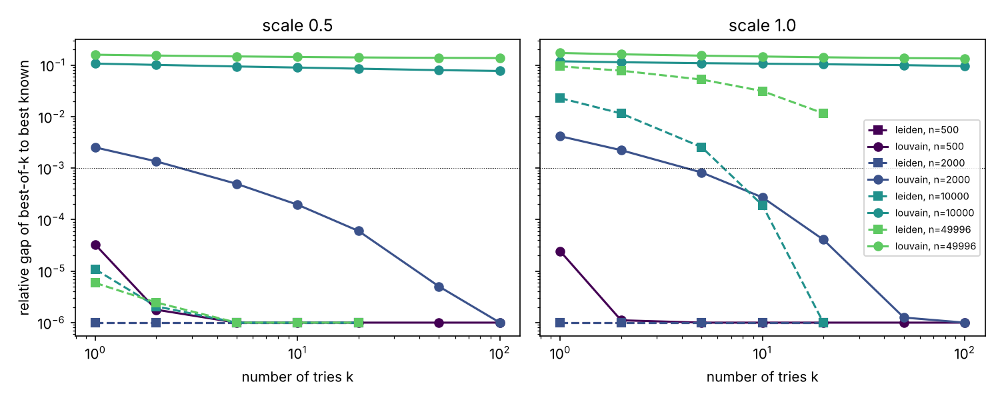

Louvain or Leiden, and how many tries?
======================================

``run`` optimises generalized Markov Stability ``n_tries`` times at each scale, with either the
C++ generalized Louvain (``method="louvain"``, the default) or Leiden (``method="leiden"``, from
`leidenalg <https://github.com/vtraag/leidenalg>`_), and keeps the best partition. This page
compares the two methods as the graph grows, to help choose the method and ``n_tries``.

Setup
-----

Planted-partition graphs with 20 equal blocks and average degree about 10 (8 edges inside the
block, 2 outside), with 500 to 50,000 nodes, using the ``linearized`` constructor (Markov time
1 is modularity) at scales 0.5 and 1. Each case runs 100 Louvain and 30 Leiden tries on one
core; every partition is scored with the same stability evaluation. The script is
``examples/benchmark/n_tries_louvain_leiden.py`` and the full results are in
``examples/benchmark/n_tries.csv``. Timings come from a shared 4-core machine and are
indicative.

Results
-------

*best of 1* is the expected stability of a single try, *best of 10* the expected best of 10
tries; *tries needed* is the smallest number of tries whose expected best is within 0.1% of the
best stability found by either method; *NMI* compares the best partition with the planted one.

.. list-table::
   :header-rows: 1

   * - nodes
     - scale
     - method
     - time / try
     - best of 1
     - best of 10
     - best known
     - tries needed
     - NMI
   * - 500
     - 1
     - louvain
     - 0.0006 s
     - 0.7604
     - 0.7604
     - 0.7604
     - 1
     - 1.00
   * - 500
     - 1
     - leiden
     - 0.03 s
     - 0.7604
     - 0.7604
     - 0.7604
     - 1
     - 1.00
   * - 2,000
     - 1
     - louvain
     - 0.003 s
     - 0.7493
     - 0.7522
     - 0.7524
     - 5
     - 1.00
   * - 2,000
     - 1
     - leiden
     - 0.15 s
     - 0.7524
     - 0.7524
     - 0.7524
     - 1
     - 1.00
   * - 10,000
     - 0.5
     - louvain
     - 0.025 s
     - 0.3158
     - 0.3219
     - 0.3536
     - > 100
     - 0.86
   * - 10,000
     - 0.5
     - leiden
     - 1.0 s
     - 0.3536
     - 0.3536
     - 0.3536
     - 1
     - 0.99
   * - 10,000
     - 1
     - louvain
     - 0.024 s
     - 0.6676
     - 0.6766
     - 0.7571
     - > 100
     - 0.81
   * - 10,000
     - 1
     - leiden
     - 1.1 s
     - 0.7398
     - 0.7570
     - 0.7571
     - 10
     - 0.99
   * - 50,000
     - 0.5
     - louvain
     - 0.30 s
     - 0.2977
     - 0.3031
     - 0.3539
     - > 100
     - 0.77
   * - 50,000
     - 0.5
     - leiden
     - 8.2 s
     - 0.3539
     - 0.3539
     - 0.3539
     - 1
     - 0.99
   * - 50,000
     - 1
     - louvain
     - 0.28 s
     - 0.6276
     - 0.6467
     - 0.7577
     - > 100
     - 0.75
   * - 50,000
     - 1
     - leiden
     - 8.8 s
     - 0.6862
     - 0.7340
     - 0.7577
     - > 30
     - 0.99

Scale 0.5 for 500 and 2,000 nodes behaves like scale 1 (both methods reach the best known
partition, Louvain within 1 and 5 tries); see the CSV file for all rows.

The figure shows, for each graph size, how far the expected best of ``k`` tries is from the
best known stability (lower is better; the dotted line is 0.1%, and gaps below 1e-6 are drawn
at 1e-6).

Take-aways
----------

- **Small graphs (up to a few thousand nodes):** both methods find the best partition. Louvain
  is about 50 times faster per try and needs at most a handful of tries, so it is the better
  choice; ``n_tries`` of 20 to 50 is plenty.
- **Large graphs (10,000 nodes and more):** Louvain gets stuck 8 to 16% below the best
  stability, with partitions that only partly match the planted one (NMI 0.75 to 0.86), and more
  tries do not close the gap (the best of 100 tries is still far off). This is a known limitation
  of the Louvain algorithm, which can merge communities badly and never undo it (on a
  20,000-node graph of the same type, igraph's own Louvain stopped at the same stability).
  Leiden's refinement step avoids it: Leiden
  recovers the planted partition (NMI 0.99) and its single try is better than Louvain's best of
  100. Use ``method="leiden"`` for large graphs.
- **Number of Leiden tries:** at coarse scales a single Leiden try is already optimal; at finer
  scales on large graphs Leiden still varies between tries (10 tries reach the best partition
  at 10,000 nodes, 30 are not quite enough at 50,000), so ``n_tries`` of 10 to 50 is a good
  range.
- **Cost:** Leiden is 30 to 50 times slower per try than the C++ Louvain (about 1 s per try at
  10,000 nodes and 8 s at 50,000 here), but because it needs far fewer tries for a better
  result, it is the better trade-off on large graphs.
